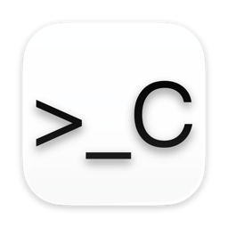
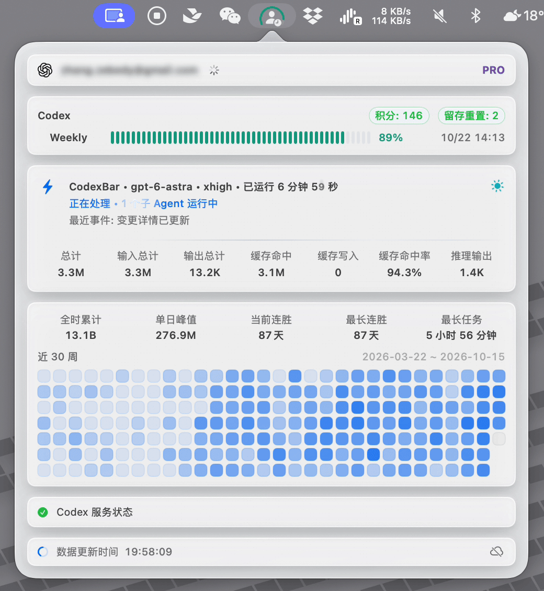

<div align="center">



# CodexBar

**Codex at a glance, right from your macOS menu bar**

[简体中文](README.md) | English

[![macOS][badge-macos]](https://www.apple.com/macos/)
[![Codex][badge-codex]](https://github.com/openai/codex)
[![Swift][badge-swift]](https://www.swift.org/)
[![Release][badge-release]](https://github.com/bob-zebedy/CodexBar/releases)
[![Downloads][badge-downloads]](https://github.com/bob-zebedy/CodexBar/releases)
[![License][badge-license]](LICENSE)

[Features](#features) | [Installation](#installation) | [Privacy](#privacy) | [Runtime Architecture](https://codexbar.zabrian.app/architecture) | [Performance Report](https://codexbar.zabrian.app/performance) | [Protocol](Protocol.en.md)



</div>

---

CodexBar is a menu bar app for macOS that displays your Codex account information, usage limits, token usage, and real-time task status in one place.

## Features

### Account and rate limits at a glance

- View your account, plan, credits, and the remaining allowance and reset time for each rate-limit window
- Show your preferred allowance directly in the menu bar
- Track banked resets and their expiry dates, with automatic use before they expire

### Follow your tasks in real time

- See each task's project, model, reasoning effort, duration, and token usage
- Follow live states, pending responses, task progress, and recent events
- Review concurrent tasks and recent completions, failures, and interruptions in Task Center

### Review your usage

- Track total usage, daily peaks, usage streaks, and your longest task duration
- Explore daily token usage and activity statistics in a heatmap
- Combine usage records across Macs through iCloud

### Get timely alerts

- Receive alerts for task completions, pending responses, allowance changes, and protection events
- Choose notification types, sounds, and task haptic feedback
- Follow status changes through customizable task glow at the top of your displays

### Keep long tasks running

- Keep your Mac awake while tasks run, then allow normal sleep when they finish
- Optionally stay awake while awaiting a response or keep the display on as well
- Set a keep-awake time limit, low-battery protection, and stalled task protection


## Installation

### Homebrew

```bash
brew install --cask bob-zebedy/tap/codexbar
```

### DMG

Download the latest version from [GitHub Releases](https://github.com/bob-zebedy/CodexBar/releases), then drag CodexBar into Applications.

## Requirements

- macOS 15.0 or later
- [Codex CLI](https://github.com/openai/codex) installed and signed in, or ChatGPT App or Codex App with bundled Codex installed
- Codex background service version `0.162.0` or later
- Cross-device sync requires an available iCloud account on the Mac

## Privacy

Raw activity events and live tasks are processed locally. Enabling cross-device sync uploads daily activity aggregates and token usage records to your private iCloud database.

## Feedback

Report bugs, request features, or ask questions through [GitHub Issues](https://github.com/bob-zebedy/CodexBar/issues).

## License

[GNU General Public License v3.0](LICENSE)

[badge-macos]: https://img.shields.io/badge/macOS-15.0%2B-6E6E73?style=flat&labelColor=E9E9ED&logo=apple&logoColor=6E6E73
[badge-codex]: https://img.shields.io/badge/Codex-0.162.0%2B-5B6CFF?style=flat&labelColor=E8EBFF&logo=%3D
[badge-swift]: https://img.shields.io/badge/Swift-6.4-F05138?style=flat&labelColor=FDE9E5&logo=swift&logoColor=F05138
[badge-release]: https://img.shields.io/github/v/release/bob-zebedy/CodexBar?style=flat&label=Release&labelColor=EFE7FB&color=8957E5&logo=github&logoColor=8957E5
[badge-downloads]: https://img.shields.io/github/downloads/bob-zebedy/CodexBar/total?style=flat&label=Downloads&labelColor=E4F3E7&color=2EA043&logo=%2BPHBhdGggZD0iTTEyIDN2MTJtLTUtNSA1IDUgNS01TTQgMTZ2NWgxNnYtNSIvPjwvc3ZnPg%3D%3D
[badge-license]: https://img.shields.io/github/license/bob-zebedy/CodexBar?style=flat&label=License&labelColor=F7EFCF&color=A67C00&logo=%2BPHBhdGggZD0iTTEyIDN2MThtLTQgMGg4TTMgN2gxOE01IDdsLTMgOGg2TDUgN1ptMTQgMC0zIDhoNmwtMy04WiIvPjwvc3ZnPg%3D%3D
